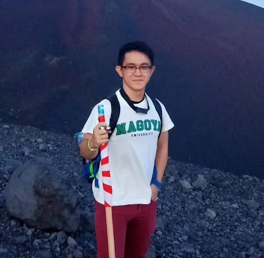

  

    

      <h1>Hi, I'm Dillon Loh</h1>
      

        I’m a software engineer at <a target="_blank" href="https://cloudlobsters.com/">Cloud Lobsters</a>, where I build scalable digital businesses and insurtech products.
        Previously, I was a software engineer at <a target="_blank" href="https://hiverlab.com/">Hiverlab</a>, where I focused on building scalable ML/CV-based solutions, web applications, and simulations.
      

      

        I did my MPhil in Machine Learning and Machine Intelligence (Computer Vision and Robotics track) at the University of Cambridge, graduating with a First-Class equivalent. My thesis on building a pipeline for object-centric 3D/4D reconstruction from egocentric videos is available <a target="_blank" href="https://github.com/dillonloh/hd-epic-3d/blob/cdcfc8eb3f234a5f4f7fbed038399e40b95a0112/Loh_HD-EPIC-3D_2026.pdf">here</a>.
      

      

        Before that, I did my BSc in Physics at Nagoya University, focusing on theoretical astrophysics research under <a target="_blank" href="https://sites.google.com/site/omegalabnagoya/member/takeuchi_tsutomu">Professor Tsutomu Takeuchi</a> at the <a target="_blank" href="https://sites.google.com/site/omegalabnagoya/home/">Laboratory of Galaxy Formation and Evolution (Ω Lab)</a>. My thesis on the use of unsupervised deep learning for analysing galactic images can be found <a target="_blank" href="https://github.com/dillonloh/galaxy-dim">here</a>.
      

      
 My full CV can be found <a target="_blank"  href="/static/Base Resume - Dillon.pdf">here</a>.
      

      

        More importantly, I squat 140kg, bench 110kg, and OHP 80kg @ 74kg bw (no i don’t deadlift). I also boxed for the Cambridge University Amateur Boxing Club at the Lightweight category (Varsity 2026, BUCS 2026), and for Nagoya University at the Bantamweight category (Captain, 2021 - 2022).
      

    

    

      
    

  

